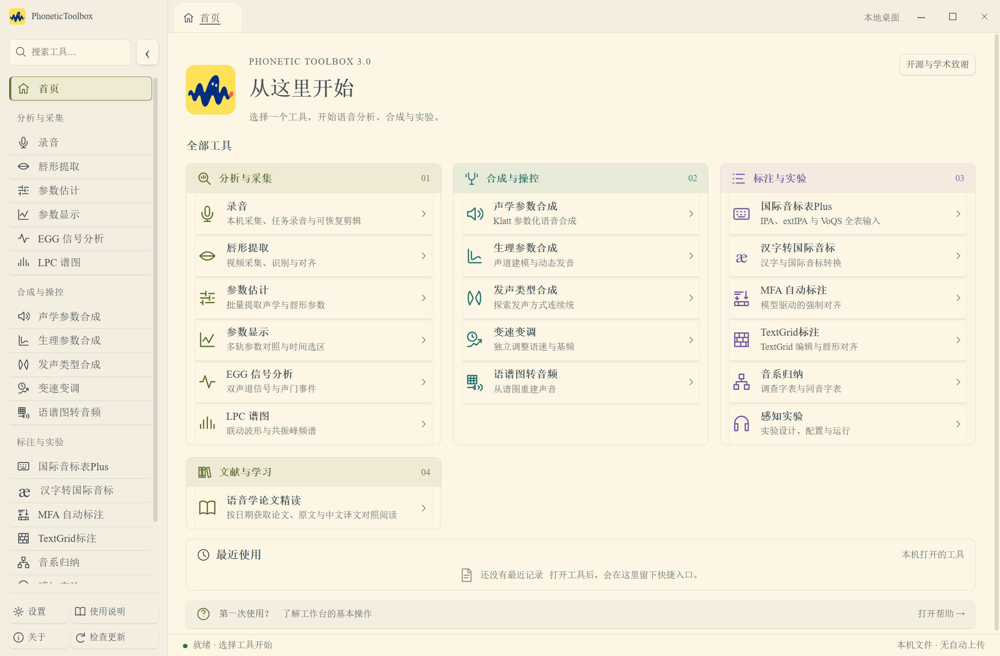
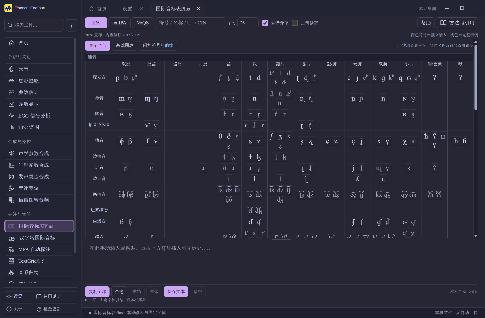
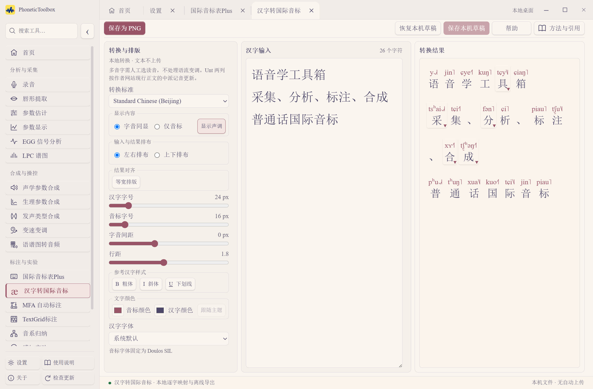
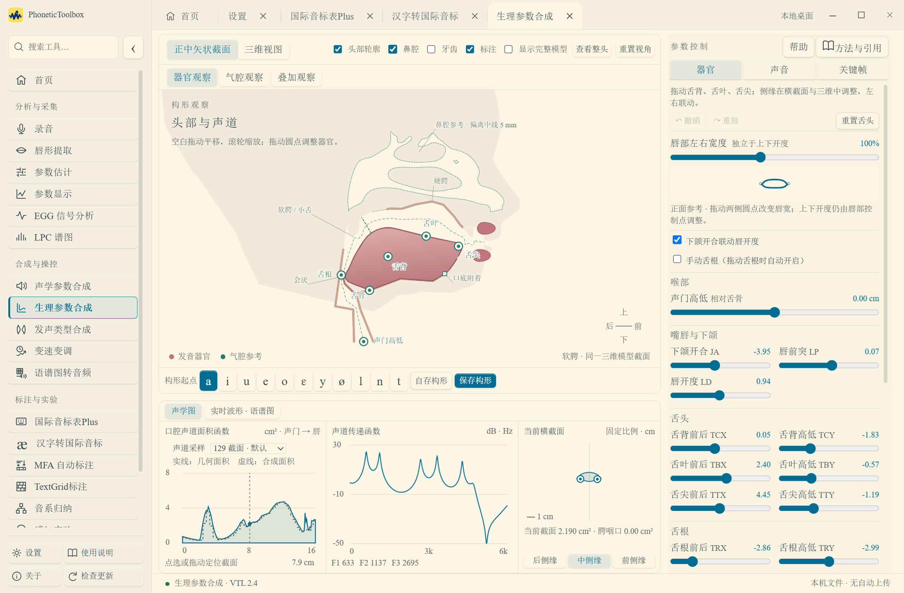
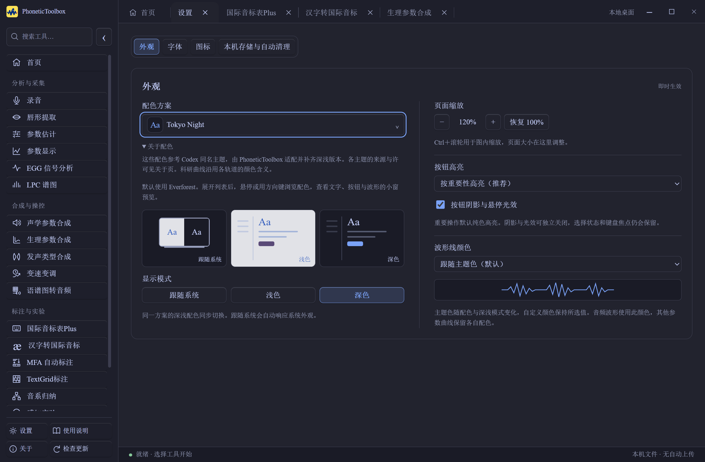

<h1 align="center">PhoneticToolbox 3.0.0 正式版</h1>

<p align="center"><strong>语音学工具箱</strong><br>把录音、分析、标注、合成与感知实验放进同一个工作台。</p>

<p align="center">
<a href="https://www.phonetictoolbox.com/"></a>
</p>

<p align="center"><a href="#下载与开始使用">下载与开始使用</a> · <a href="#全部模块">全部模块</a> · <a href="#文档与开发">开发文档</a> · <a href="#来源许可与历史版本">来源与许可</a></p>

**Windows 10 1809+ / Windows 11 · x64（Intel / AMD）· 18 个工具**

PhoneticToolbox 面向语言学、实验语音学的研究与教学。十八个工具共用侧栏、标签页、设置、文件操作和使用说明。从录音出发，可以查看波形与语谱图、提取参数、整理标注，再进入语音合成、音系分析或感知实验。



## 下载与开始使用

### 选择 Windows 版本

在[官方网站](https://www.phonetictoolbox.com/)获取当前 Windows 版本。安装版适合日常使用，免安装版适合直接启动或放在自选目录中。两类应用提供相同的工具。

| 版本 | 文件名 | 使用方式 |
| --- | --- | --- |
| 免安装版 | `PhoneticToolbox-windows-x64.exe` | 双击启动，无需运行安装向导 |
| 安装版 | `PhoneticToolbox-3.0.0-windows-x64-setup.exe` | 按当前用户安装，默认不要求管理员权限，创建应用入口 |

系统要求为 **Windows 10 1809 及以上或 Windows 11、64 位 x64 系统**。可在 Windows **设置 → 系统 → 关于 → 系统类型**中核对。当前尚未提供 x86、ARM64、macOS 或 Linux 发行包。

安装版默认放在 `%LOCALAPPDATA%\Programs\PhoneticToolbox`。安装完成后，从开始菜单或已创建的桌面快捷方式启动应用。主程序下载包小于 500 MB，第一次打开会准备本机运行文件，展开后的磁盘占用更大。**MFA 运行环境、声学模型和发音词典独立下载，主包不包含这些组件。**

也可从 [GitHub Releases](https://github.com/Nephelium/PhoneticToolbox/releases)选择对应版本，历史发布继续保留。下载时请核对版本号。当前 Windows 成品的验证范围见[发行说明](docs/testing/windows-current-release.md)。

### 第一次使用

1. 启动应用，从首页或侧栏选择工具。工具在标签页中打开，可随时切换。
2. 导入对应的音频、视频、TextGrid、参数表或工程文件。
3. 核对输入声道、时间范围、分析方法与参数，再开始分析、编辑或合成。
4. 用模块中的保存或导出入口保存成果，按需要继续在其他工具中处理。
5. 点击工具中的**帮助**查看对应章节，或从左下角**使用说明**打开完整说明书。

## 用一个工作台连接研究环节

| 研究任务 | 可以这样开始 | 常见成果 |
| --- | --- | --- |
| 采集与声学分析 | 录音或导入已有音频，提取参数，再查看时间轨迹、EGG 与局部频谱 | 音频、参数表、分析图 |
| 标注与音系整理 | 导入 TextGrid，编辑标注边界和标签，或用已有转写进行 MFA 对齐 | TextGrid、调查字表、同音字表 |
| 语音操控与合成 | 编辑基频和时长，调整声学参数、发声类型或声道构形 | 合成音频、参数工程、动作视频 |
| 教学与感知研究 | 查询音标、转换汉字读音，设计感知实验，阅读和批注语音学论文 | 音标文本与图片、实验配置和记录、阅读批注 |

波形、语谱图、参数轨迹与 TextGrid 在相应工具中共享时间位置。可以从整段录音定位到局部选区，核对标签与信号，再保存所需的数值和图片。MFA 的自动对齐结果可交给 TextGrid 标注工具人工复核。

### 查找、输入和说明音标

**国际音标表Plus**提供 IPA、extIPA 与 VoQS 三套表，支持符号、名称和码位检索，查看符号介绍、输入文本及保存草稿。音标字体随应用提供，便于标注、写作与课堂演示。音标演示媒体仍在持续制作，当前可用内容以界面为准。



### 把汉字与读音放在一起

**汉字转国际音标**实时显示字音对照，提供转换标准、多音字选读、儿化组合和结果排版。可调整字音字号、颜色、间距与对齐，再保存为 PNG。转换在本机进行，多音字需人工选读音，工具不自动处理语流变调。



### 从声道构形观察发音

**生理参数合成**将发音器官、声道面积与传递函数放在同一工作区。可以从预设构形开始，调整器官参数，比较截面与声学变化，再用关键帧组织发音动作、试听或保存同步视频。下图展示默认的 VTL `/a/` 构形及其模型计算结果，预设用于构形起点，普通话标准音仍需结合声学与听辨核对。



### 调整工作台外观与设置

设置分为外观、字体、图标、本机存储与自动清理四类。配色支持浅色、深色和跟随系统，可调整页面缩放、正文与图表字体、按钮高亮和波形颜色。侧栏及部分工具面板可以拖动调整宽度，偏好在本机保存。启动提示的图标与配色会随所选应用图标调整。



本页当前应用截图由同一份 Windows 3.0.0 EXE 实际运行取得。采集方式、文件摘要和展示范围见[配图说明](docs/assets/readme/README.md)。

## 全部模块

每个模块的独立 README 说明功能、输入输出、方法来源和验证范围。应用内说明书提供面向操作的图文步骤。

| 方向 | 模块与独立说明 | 主要用途 |
| --- | --- | --- |
| 分析与采集 | [录音](frontend/src/modules/recording/README.md) | 本机采集、任务录音与可恢复剪辑 |
| 分析与采集 | [唇形提取](frontend/src/modules/lip-extraction/README.md) | 视频采集、唇形识别与时间对齐 |
| 分析与采集 | [参数估计](frontend/src/modules/parameter-estimation/README.md) | 批量提取声学与唇形参数，关联 TextGrid |
| 分析与采集 | [参数显示](frontend/src/modules/parameter-display/README.md) | 多轨参数对照、时间选区与图像导出 |
| 分析与采集 | [EGG 信号分析](frontend/src/modules/egg-analysis/README.md) | 音频与 EGG 联动、接触商、声门事件与逆滤波 |
| 分析与采集 | [LPC 谱图](frontend/src/modules/lpc-spectrum/README.md) | 波形、标注与局部 LPC 频谱联动 |
| 合成与操控 | [声学参数合成](frontend/src/modules/speech-synthesis/README.md) | Klatt 参数化语音合成 |
| 合成与操控 | [生理参数合成](frontend/src/modules/vocal-tract/README.md) | 声道建模、动态发音与动作视频 |
| 合成与操控 | [发声类型合成](frontend/src/modules/phonation-synthesis/README.md) | 探索发声方式连续统 |
| 合成与操控 | [变速变调](frontend/src/modules/pitch-manipulation/README.md) | 调整语速与基频，试听和批量生成 |
| 合成与操控 | [语谱图转音频](frontend/src/modules/spectrogram-to-audio/README.md) | 从谱图重建声音，进行频谱编辑 |
| 标注与实验 | [国际音标表Plus](frontend/src/modules/ipa-plus/README.md) | IPA、extIPA 与 VoQS 查找、介绍和输入 |
| 标注与实验 | [汉字转国际音标](frontend/src/modules/mandarin-ipa/README.md) | 汉字读音转换、字音对照与图片导出 |
| 标注与实验 | [MFA 自动标注](frontend/src/modules/mfa/README.md) | 依据已有转写进行强制对齐 |
| 标注与实验 | [TextGrid 标注](frontend/src/modules/annotation/README.md) | 多层标注编辑、边界调整与唇形对齐 |
| 标注与实验 | [音系归纳](frontend/src/modules/phonology-induction/README.md) | 调查字表、音系分析与同音字表 |
| 标注与实验 | [感知实验](frontend/src/modules/perception/README.md) | 实验设计、配置与运行 |
| 文献与学习 | [语音学论文精读](frontend/src/modules/paper-reading/README.md) | 论文库、PDF 阅读、译读对照与批注 |

## MFA 独立组件

首次使用 MFA，在模块中点击**下载并安装组件**。也可选择发布者提供的组件 ZIP，或已经解压的组件文件夹。应用显示下载进度、大小与速度，随后自动校验、解压并检查可运行性。

当前组件为 **MFA 3.3.8-r1 / Windows x64 / CPU**，包含默认普通话声学模型和发音词典。组件通过应用内入口从官网独立下载，也支持同版 ZIP 离线安装。其他语言可从模块内的官方资源按钮取得匹配的模型和词典，再导入检查。

组件下载约 813 MB，安装后约 2.81 GB，解压过程中还需要临时空间。

MFA 根据已有文本寻找音频中的对齐位置。请准备同名 WAV 与 LAB、TXT 或适用的 TextGrid 转写，并核对词典覆盖与模型音素。结果保存到独立目录，原有 TextGrid 保留。详细流程、兼容要求和方法来源见[MFA 模块说明](frontend/src/modules/mfa/README.md)。

## 帮助、反馈与数据保存

**说明书随应用提供。** 模块内的帮助可直达当前工具章节，说明书图片可放大，音频与演示媒体可在阅读时播放。内容持续修订，具体功能与操作以当前版本为准。

**问题反馈位于关于页。** 首次提交时验证联系邮箱，无需注册账号。可以附上问题描述和截图，后续回复保存在应用内，并可选择是否接收邮件提醒。关于页同时提供官方网站、软件与代码来源、字体许可等入口。

**需要长期保留的成果，请导出到自己的研究目录。** 本机存储与自动清理页提供当前占用和缓存清理入口。运行缓存清理后，下次启动会重新准备；未导出的内部处理结果被清理后，需要重新计算。用户导入的原始录音和保存到研究目录的成果由用户管理。

应用通过**检查更新**获取新版信息，当前更新下载完整新版应用包。也可以关闭应用后，在原目录安装或替换新版。设置、草稿、研究文件及已安装的 MFA 组件沿用原存储位置。卸载安装版时，可选择删除应用管理的 MFA 组件，默认保留；自行指定的外部环境保留。

## 文档与开发

| 想做什么 | 从这里开始 |
| --- | --- |
| 学习操作 | 应用内**使用说明**，或各模块**帮助** |
| 查某个模块的功能、格式与限制 | 上方模块表中的独立 README |
| 了解源码结构与职责 | [总架构](ARCHITECTURE.md)、[文档导航](docs/README.md) |
| 配置环境并启动源码 | [开发说明](docs/development.md)、[统一源码入口](docs/development/source-entry.md)、[依赖清单](requirements/README.md) |
| 修改正式说明书 | [说明书工程](manual/README.md)、[独立说明书编辑器](tools/manual-studio/README.md) |
| 构建 Windows 发行包 | [发行工程](release/README.md)、[打包要求](release/PACKAGING_RULES.md) |
| 查看进展与验证 | [当前状态](docs/project-status.md)、[验证策略](docs/testing/verification-plan.md) |

界面使用 Vue 3，桌面宿主使用 PyQt6 / Qt WebEngine。科学计算与文件格式位于 `packages/phonetic_core`，本机任务由 `backend` 管理。开发环境需要 Python、Node.js、各科学模块环境及相应原生组件，按[统一源码入口](docs/development/source-entry.md)配置后，在工程根目录启动：

```powershell
.\scripts\Start-Research-Workbench.ps1 -CheckOnly
.\scripts\Start-Research-Workbench.ps1
```

前端命令在 `frontend` 目录运行：

```powershell
npm ci
npm run contracts:check
npm run ui-data:check
npm run typecheck
npm test
npm run build
```

请按改动范围运行验证。模块 README 记录计算方法，验证报告注明实际检查的平台、设备与范围。科学准确率、实体音视频设备、长期运行和其他系统需分别核验。

## 来源、许可与历史版本

科学方法、代码、字体、模型、词典和数据分别登记。应用内**方法与引用**及**关于**可查相关信息，详细记录见[第三方来源与许可](third_party/README.md)。项目整体发行许可证及部分第三方代码的再分发条件仍在确认，当前不作统一的商用许可承诺。

公开仓库提供维护源码、必要资源和可公开文档。用户原始录音、研究数据、下载的论文全文，以及说明书中仅限随软件分发的媒体不随公开源码提供。本页当前截图使用任务专属的隔离配置与示例文本，来源见[配图说明](docs/assets/readme/README.md)。

默认分支 `main` 承载 v3，旧版源码保留在独立的 [v2 分支](https://github.com/Nephelium/PhoneticToolbox/tree/v2)。旧版本可通过[历史发布](https://github.com/Nephelium/PhoneticToolbox/releases)和 [v2.1.4 标签](https://github.com/Nephelium/PhoneticToolbox/tree/v2.1.4)查阅。
