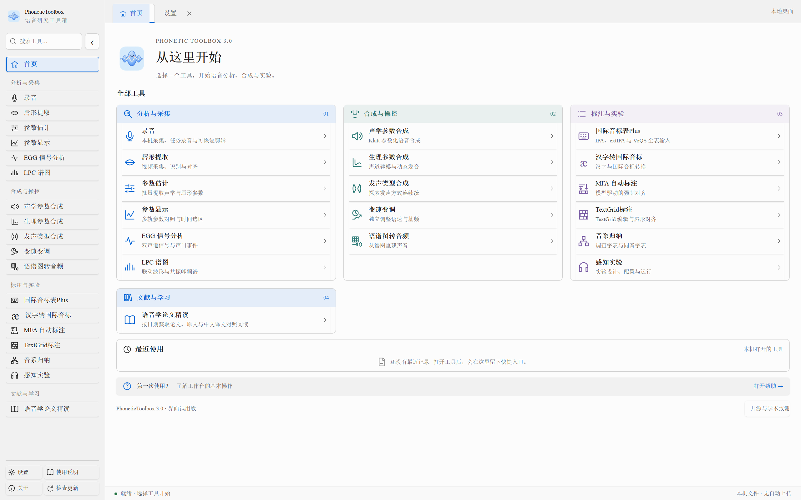
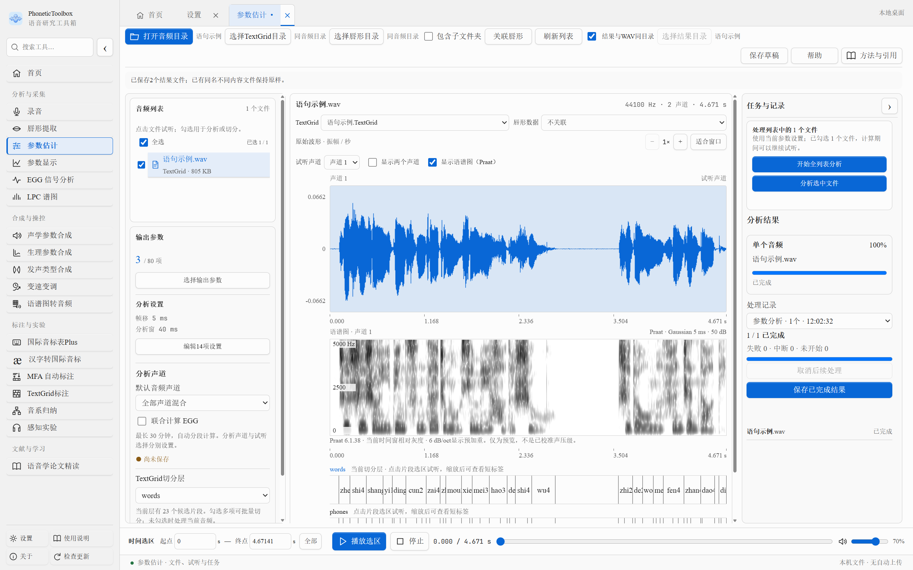
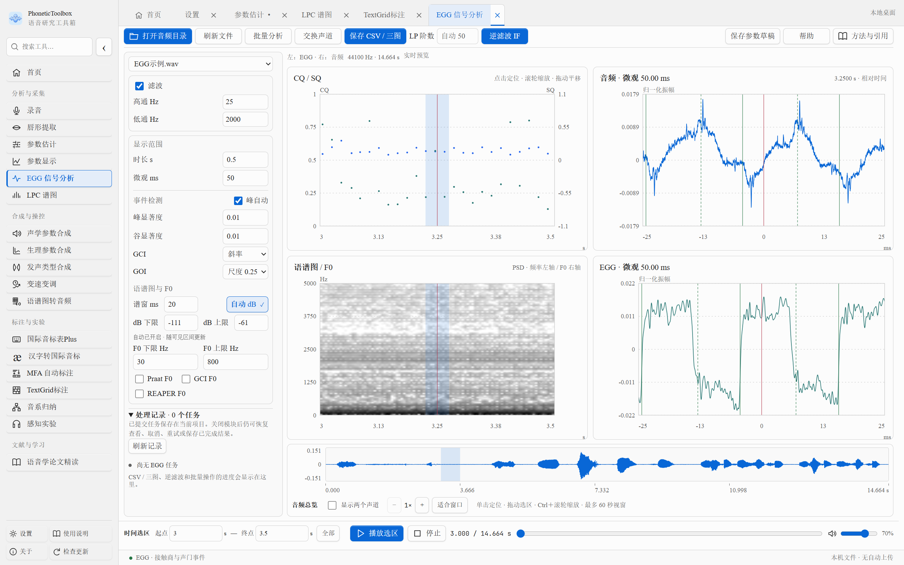
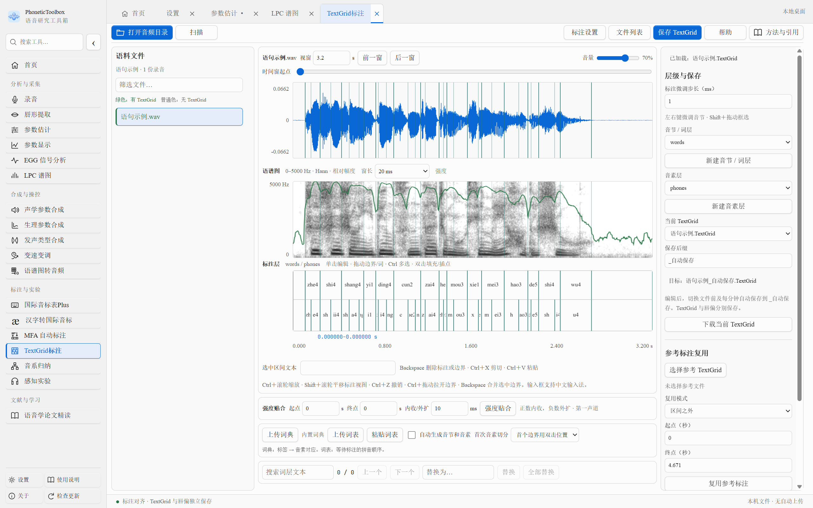
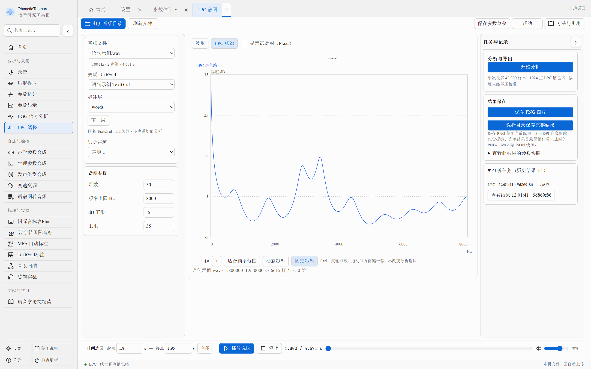
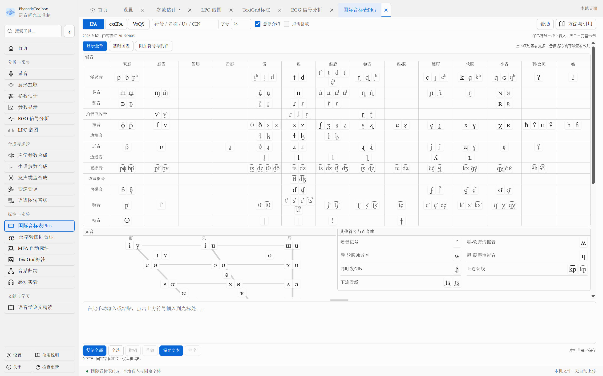

# PhoneticToolbox 3.0 Preview

**把录音、分析、标注、合成与感知实验放进同一个语音学工作台。**

PhoneticToolbox 面向语言学、实验语音学的研究与教学。18 个工具共用侧栏、标签页、设置和使用说明，支持从真实录音出发，查看波形与语谱图、提取参数、调整标注，再进入合成或实验设计。

[软件官网](https://www.phonetictoolbox.com/) · [全部模块](#全部模块) · [安装与开始使用](#安装与开始使用) · [开发文档](docs/README.md) · [来源与许可](third_party/README.md)

**当前版本：3.0.0-preview.1 · Windows 10 1809+ / Windows 11 · x64（Intel / AMD）**



## 从真实录音开始

下面的分析截图来自实际运行的 Windows 工作台。语句示例使用作者提供的真人录音及其原有 TextGrid，EGG 示例使用真实双声道同步记录。输入按原始字节复制，仅用通用文件名展示；没有用合成音频替代录音，也没有重绘分析结果。截图来源与参数见[配图说明](docs/assets/readme/README.md)。

### 提取声学参数，保留时间与标注信息

**参数估计**支持批量处理、选择输出参数，以及与 TextGrid、唇形数据关联。波形、语谱图和标注层共用时间位置。结果可继续交给**参数显示**，比较不同指标及其时间变化。



*示例录音为 44.1 kHz、双声道、约 4.671 秒。本次任务实际计算了 Praat F0、F1、F2；图中的标注来自配套 TextGrid。*

### 在同一视野中核对声学与 EGG 信号

**EGG 信号分析**联动显示 CQ / SQ、语谱图、音频波形和 EGG 波形。可以从整段录音定位到局部，再观察毫秒级微观窗口中的事件标记，并按需要导出 CSV、分析图或进行逆滤波。



*示例展示原录音 3.00–3.50 秒，微观窗口为 50 ms。图中的事件和参数由当前方法实际计算，科研解释与方法限制见 [EGG 模块说明](frontend/src/modules/egg-analysis/README.md)。*

### 让波形、语谱图和 TextGrid 一起工作

**TextGrid 标注**支持多层标注、边界调整、词典与词表辅助，以及参考标注复用。**MFA 自动标注**可先对已有转写进行强制对齐，再将结果交给标注模块人工复核。



*此图直接载入配套的原有标注，展示标注编辑工作区；它不作为本轮 MFA 对齐准确率的证据。*

<details>
<summary><strong>查看更多：LPC 频谱与国际音标表</strong></summary>

### 观察局部频谱

**LPC 谱图**将时间选区、TextGrid 标签和频谱分析关联起来。下图是同一真人语句录音在 1.80–1.95 秒的实际 LPC 结果，可调整阶数、频率上限与显示范围。



### 查找和输入音标

**国际音标表Plus**整合 IPA、extIPA 与 VoQS 的查找、输入和说明入口，可用于标注、写作与教学。



</details>

## 全部模块

每个模块都有独立 README，说明当前行为、输入输出、源码职责、方法来源及验证范围。应用内的使用说明提供面向操作的图文步骤。

| 方向 | 模块与独立说明 | 主要用途 |
| --- | --- | --- |
| 分析与采集 | [M16 · 录音](frontend/src/modules/recording/README.md) | 本机采集、任务录音与可恢复剪辑 |
| 分析与采集 | [M05 · 唇形提取](frontend/src/modules/lip-extraction/README.md) | 视频采集、唇形识别与时间对齐 |
| 分析与采集 | [M01 · 参数估计](frontend/src/modules/parameter-estimation/README.md) | 批量提取声学与唇形参数 |
| 分析与采集 | [M02 · 参数显示](frontend/src/modules/parameter-display/README.md) | 多轨参数对照与时间选区 |
| 分析与采集 | [M03 · EGG 信号分析](frontend/src/modules/egg-analysis/README.md) | 双声道信号、接触商与声门事件 |
| 分析与采集 | [M04 · LPC 谱图](frontend/src/modules/lpc-spectrum/README.md) | 波形、标注与 LPC 频谱联动 |
| 合成与操控 | [M06 · 声学参数合成](frontend/src/modules/speech-synthesis/README.md) | Klatt 参数化语音合成 |
| 合成与操控 | [M10 · 生理参数合成](frontend/src/modules/vocal-tract/README.md) | 声道建模与动态发音 |
| 合成与操控 | [M07 · 发声类型合成](frontend/src/modules/phonation-synthesis/README.md) | 探索发声方式连续统 |
| 合成与操控 | [M08 · 变速变调](frontend/src/modules/pitch-manipulation/README.md) | 调整语速与基频 |
| 合成与操控 | [M09 · 语谱图转音频](frontend/src/modules/spectrogram-to-audio/README.md) | 从谱图重建声音与频谱编辑 |
| 标注与实验 | [M17 · 国际音标表Plus](frontend/src/modules/ipa-plus/README.md) | IPA、extIPA 与 VoQS 查找和输入 |
| 标注与实验 | [M13 · 汉字转国际音标](frontend/src/modules/mandarin-ipa/README.md) | 汉字与国际音标转换 |
| 标注与实验 | [M11 · MFA 自动标注](frontend/src/modules/mfa/README.md) | 依据已有转写进行强制对齐 |
| 标注与实验 | [M12 · TextGrid 标注](frontend/src/modules/annotation/README.md) | 多层标注编辑与唇形对齐 |
| 标注与实验 | [M14 · 音系归纳](frontend/src/modules/phonology-induction/README.md) | 调查字表、音系分析与同音字表 |
| 标注与实验 | [M15 · 感知实验](frontend/src/modules/perception/README.md) | 实验设计、配置与运行 |
| 文献与学习 | [M18 · 语音学论文精读](frontend/src/modules/paper-reading/README.md) | 论文获取、PDF 阅读、译读对照与批注 |

## 安装与开始使用

### 系统要求与版本选择

| 项目 | 当前支持 |
| --- | --- |
| 操作系统 | Windows 10 1809 及以上，或 Windows 11 |
| 架构 | x64：Intel / AMD 64 位处理器与 64 位 Windows，也称 AMD64、x86_64 |
| 安装版 | 文件名含 `windows-x64-setup.exe`，按当前用户安装，默认不要求管理员权限 |
| 免安装版 | `PhoneticToolbox-windows-x64.exe`，双击启动，首次打开自动准备运行文件 |
| 其他平台 | 尚未提供 x86、ARM64、macOS 或 Linux 发行包 |

可在 Windows **设置 → 系统 → 关于 → 系统类型**中核对架构。安装版默认放在 `%LOCALAPPDATA%\Programs\PhoneticToolbox`。两类主程序包均控制在 500 MB 以内，展开后的运行文件占用更大。

**v3 Preview 的完整发行包尚未公开发布。** [GitHub Releases](https://github.com/Nephelium/PhoneticToolbox/releases) 中的已发布版本可能仍为 v2，下载时请核对版本号。当前本机构建与验证范围见 [Windows 发行说明](docs/testing/windows-current-release.md)。

1. 启动应用，从首页或侧栏打开需要的工具。
2. 导入音频、视频、TextGrid 或相应工程文件，核对输入和分析参数。
3. 完成分析、标注或合成后，按模块入口保存结果。
4. 点击模块中的**帮助**进入对应说明书章节；从**关于 → 问题反馈**提交问题和截图。

### MFA 独立组件

首次使用 MFA 时，在模块中点击**下载并安装组件**；也可选择发布者提供的组件 ZIP 或已经解压的组件文件夹。下载过程显示进度、已下载大小及速度，随后自动校验、解压并检查可运行性。

当前独立组件固定为 **MFA 3.3.8-r1 / Windows x64 / CPU**，包含默认普通话声学模型与词典。其他语言可通过模块内的官方资源按钮下载匹配的模型和词典。MFA 组件独立于主应用分发，官网组件文件尚待上传，具体状态与操作见 [MFA README](frontend/src/modules/mfa/README.md)。

### 更新与数据

当前更新方式下载完整新版应用包。关闭应用后可在原目录覆盖安装，设置、草稿、研究文件及已安装的 MFA 组件会保留。运行缓存可在设置中清理，下一次启动会重新准备；未导出的内部处理结果被清理后需要重新计算。

卸载安装版时可选择删除本应用管理的 MFA 组件，默认保留；自行选择的外部环境保留。数据保留、清理期限及本轮成品验证边界以[当前发行说明](docs/testing/windows-current-release.md)和应用内说明书为准。

## 文档与开发

| 想做什么 | 从这里开始 |
| --- | --- |
| 学习操作 | 应用内**使用说明**，或各模块**帮助** |
| 找某个模块的功能与限制 | 上方模块表中的独立 README |
| 了解源码结构与职责 | [总架构](ARCHITECTURE.md)、[文档导航](docs/README.md) |
| 配置环境并启动源码 | [开发说明](docs/development.md)、[统一源码入口](docs/development/source-entry.md)、[依赖清单](requirements/README.md) |
| 修改正式说明书 | [说明书工程](manual/README.md)、[独立说明书编辑器](tools/manual-studio/README.md) |
| 构建发行包 | [发行工程](release/README.md)、[打包要求](release/PACKAGING_RULES.md) |
| 查看进展与验证 | [当前状态](docs/project-status.md)、[验证策略](docs/testing/verification-plan.md) |

界面使用 Vue 3，桌面宿主使用 PyQt6 / Qt WebEngine，科学计算与文件格式在 `packages/phonetic_core`，本机任务由 `backend` 管理。开发环境按文档配置 Python、Node、各科学模块环境及原生组件后，从统一入口启动：

```powershell
.\scripts\Start-Research-Workbench.ps1 -CheckOnly
.\scripts\Start-Research-Workbench.ps1
```

前端安装与检查命令在 `frontend` 目录运行：

```powershell
npm ci
npm run contracts:check
npm run ui-data:check
npm run typecheck
npm test
npm run build
```

请按改动范围运行相应验证。模块 README 记录各自的计算方法与验收边界；某次本机检查通过，不代表所有设备和平台均已验证。

## 来源、许可与历史版本

科学方法、代码、字体、模型、词典和数据分别登记，应用内**方法与引用**及**关于**可查看相关信息。详见[第三方来源与许可](third_party/README.md)。项目整体发行许可证及部分第三方代码的再分发条件仍在确认，当前不作统一的商用许可承诺。

本页使用作者明确指定的真实录音制作静态截图。原始录音、TextGrid、研究数据及说明书中仅限随软件分发的媒体不随公开源码提供；截图使用范围见[配图来源说明](docs/assets/readme/README.md)。

默认分支 `main` 承载 v3，旧版源码保留在独立的 [v2 分支](https://github.com/Nephelium/PhoneticToolbox/tree/v2)。今后 v3 源码更新继续同步到 `main`。

v3 延续本项目的 Git 历史，旧版本可通过[历史发布](https://github.com/Nephelium/PhoneticToolbox/releases)和 [v2.1.4 标签](https://github.com/Nephelium/PhoneticToolbox/tree/v2.1.4)查阅。README 描述当前 v3 工作树，默认分支和已发布安装包的版本请分别核对。
