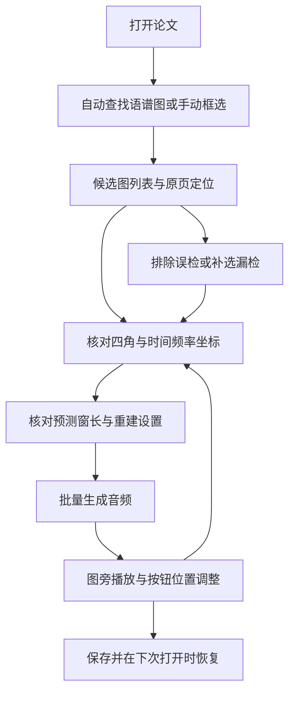

# 论文语谱图识别、重建与随文播放实施规划

日期：2026-10-16。状态：`planned`。本次交付为规划，尚未实施新功能、标注新数据或训练新模型。

**目标：** 用户在论文精读中一键查找语谱图，核对或修改裁剪、坐标和重建参数，批量生成音频，并在图旁播放。所有阶段支持人工检查，关闭应用后能够继续编辑。

**架构：** 论文服务负责文档身份、图像取样及持久工程，已有语谱图任务负责参数预测和声音重建。识图与坐标读取作为独立推理步骤，经受管后台执行，与阅读页面的交互解耦。技术取舍集中在[专题 ADR](../decisions/ADR-paper-spectrogram-audio.md)，本计划维护任务、顺序和验收。

**技术基础：** 现有 Vue/TypeScript、Qt PDF、Python 科学任务及本地文件机制。检测器、OCR 和部署运行时均为候选，正式选择由论文样本效果、CPU 开销、许可与包体实测决定。

## 1. 下一步先做什么

建议先启动第 0 阶段与第 1 阶段，以一个可保存、可反复修改的手动版本验证完整体验，同时固定训练标注格式。检测模型随后接入同一接口。

| 顺序 | 具体动作 | 交付物 |
| --- | --- | --- |
| 1 | 井井指定用于开发与评估的论文目录，选 10–20 篇具有不同版式的样本，记录使用范围 | 样本清单、内容摘要、材料用途与授权记录 |
| 2 | 人工核对约 30–50 幅独立谱图区，包含扫描图、组合图、无框图及非零坐标起点 | 标注规范、首批人工基准及困难类型清单 |
| 3 | 用同一篇论文完成框选、四角调整、填参数、生成、图旁播放 | 首个实际可用流程 |
| 4 | 关闭重开、移动按钮、改参数重算，核对原文和译文不混用 | 可恢复的论文音频工程 |
| 5 | 固定候选图接口与评价标准，随后比较小检测器和坐标读取方案 | 模型实验任务书和首轮训练配置 |

样本数量是启动预算，可按已获授权的实际材料调整。合成 PDF 可先支持工程测试，不能替代真实论文泛化评估。已有《The Sound Spectrograph》与 Markina Basque 转换记录可作为开发回归参考，实际重用前核对输入与参数摘要，不能因已有试听就认定自动识别通过。已被查看或调试过的材料不作为全新盲测集。

本计划编写不要求井井现在整理材料。开始实施时，秋叶先完成不依赖真实论文的契约和合成夹具，再使用井井指定的材料目录，不扫描其他研究目录。

## 2. 用户操作与首版范围

### 2.1 完整使用流程



候选图列表按页码、图组和子图排列，显示缩略图、页码、可编辑名称及当前状态。点击条目定位到原页。用户可以排除误检、补选漏检、拆分组合图、合并重复检测、批量生成选中图或仅生成当前图。

核对面板提供原页上下文、内部谱图区及重建结果预览。时间起点、终点和时长联动，时长始终为终点减起点，三者不能分别保存矛盾数值。频率上下限、单位、轴类型、窗长、动态范围、迭代次数、算法、初始化方式和输出采样率均保留现有适用编辑能力。模型支持范围外的设置给出可执行提示。

四角可拖动并可用键盘精调。显示缩放不改变实际坐标。用户可以重置自动建议，但普通重新检测不能覆盖已确认值。面板折叠后仍可直接点图旁按钮试听，详细模型身份和诊断留在详情与工程记录中。

### 2.2 首次交付与后续覆盖

| 交付层次 | 包含范围 | 暂未自动支持时的行为 |
| --- | --- | --- |
| 手动首版 | Windows 本地 PDF、人工框选、四角、现有线性/对数轴、现有重建方法、图旁按钮、保存恢复 | 用户填写标定，未知值可留待补充 |
| 自动识图版 | 整篇查找、普通印刷与扫描页、多个独立子图、误检排除与漏检补选 | 保留手动框选，说明未完成页 |
| 自动标定版 | 可读时间/频率刻度、单位换算、共享轴关联、字段级证据与待检查列表 | 不确定项集中核对，不悄悄填入固定时长或频率 |
| 稳定批量版 | 逐图失败隔离、取消/重试、断点恢复、长论文资源控制、离线打包验收 | 保留已完成结果与明确的剩余任务 |
| 后续扩展 | 彩色标度、复杂非线性轴、真实曲页、超过现有时长预算的图、跨阅读器媒体 PDF 导出 | 独立定义算法和兼容验收，不强行当作普通灰度 STFT 图重建 |

最终入口可以称为查找全部语谱图或生成全部就绪音频。界面应显示已处理页数、发现数量和待检查数量，不将查找完成解释为已经证明没有漏图。

## 3. 当前基础与需要补齐的部分

以下依据 2026-10-16 的本机源码只读核对，描述源码能力，不代表本次运行或最终成品验收。

| 部分 | 当前基础 | 本任务新增 |
| --- | --- | --- |
| PDF 页面 | `desktop/src/ptb_desktop/papers.py` 的 `render` 返回页面图、文本和行级相对位置 | 独立分析取样、局部高质量裁图、坐标变换记录，必要时更细文字定位 |
| 阅读界面 | `frontend/src/modules/paper-reading/PdfReader.vue` 已有连续阅读、缩放、选字和批注覆盖 | 语谱图覆盖层、编辑面板、批量列表、音频按钮及拖动 |
| 持久身份 | 批注按 PDF 内容摘要保存，原文/译文/解读分别取得资产 | 新增版本化音频工程，避免借用文字批注结构塞入模型数据 |
| 标定与重建 | `Spec2WavPage.vue`、`spec2wav_models.py` 及 `phonetic_core/spec2wav` 已支持四角、时间/频率与重建设置 | 抽取共享参数和校正交互，提供论文任务适配，不复制算法 |
| 参数预测 | 已有窗长与动态范围预测，需要先给出时长、频带和轴类型 | 保存预测依据与用户覆盖，坐标读取完成后再预测 |
| 结果保存 | 已有 WAV、校正图、重建图、参数 JSON | 将用户保留的结果写入论文工程，脱离临时任务缓存寿命，并可重新编辑 |
| 几何研究 | 独立研究项目已有谱图区与形变网格模型 | 用真实论文候选图评估，明确输出网格与四角编辑的关系 |

现有重建有 30 秒、像素、FFT 和迭代预算。首期逐图沿用有效限制，超限图显示原因。扩大这些限制应单列算法、性能与取消验收。研究项目和应用的默认参数可能不同，接入时固定应用方法版本和实际参数，不直接照搬最新研究脚本默认值。

## 4. 阶段任务与完成条件

下列文件均以仓库根目录为基准，完整根目录为 `D:/PhoneticToolbox/PhoneticToolbox_v3`。标有新增的文件是拟定位置，实施时才创建。各阶段先锁定关键行为测试，再实现并运行对应检查。低风险文案不增加镜像式测试。

### 第 0 阶段：样本、标注和数据契约

任务 ID：`PAPER-AUDIO-BASELINE`。依赖：实施启动及材料范围确定。

1. 建立逐文档清单，记录 PDF 摘要、页数、版本、来源、材料用途和允许的训练/分发范围。
2. 标注上下文外框、内部谱图区、四角顺序、图组/子图关系、轴刻度和值、单位及文字证据。
3. 区分已知、推测、缺失和不适用，不用零值代替未知。记录图内标记、彩色标度、频带缺失和失真类型。
4. 冻结首批合成工程夹具、人工标定回归集及后续按论文划分的验证策略。
5. 新增 `contracts/paper-audio/README.md`，固定请求、坐标、字段来源、修订与任务状态约定。定义完成后再接 UI。

完成条件：同一图由两人或两次独立复核能够解释差异；非零时间起点、共享轴、旋转页、缺刻度和空白页都有明确样例。契约完整覆盖用户提出的可编辑项。

### 第 1 阶段：手动选图到图旁播放

任务 ID：`PAPER-AUDIO-MANUAL`。依赖：第 0 阶段契约。

实施顺序：

1. 新增 `desktop/src/ptb_desktop/paper_audio_store.py` 与 `desktop/tests/test_paper_audio_store.py`，先实现版本化保存、原子提交、修订冲突及文档隔离。
2. 新增 `desktop/src/ptb_desktop/paper_audio.py`，在已有论文服务中解析受控文档身份并裁图。补 `desktop/tests/test_paper_audio.py`，验证页码、旋转、裁剪范围、输入摘要和内存预算。
3. 在 `desktop/src/ptb_desktop/papers_bridge.py`、`frontend/src/platform/papers.ts` 增加有界请求与后台任务状态。慢任务不在页面渲染队列同步运行。
4. 从 `frontend/src/modules/spectrogram-to-audio/Spec2WavPage.vue` 提取共用标定 UI 与状态逻辑到同目录新增 `ReconstructionSettings.vue`、`calibration.ts`，原模块与论文编辑共同使用。保留已有小数输入和方法语义。
5. 在 `frontend/src/modules/paper-reading/PdfReader.vue` 挂接新增 `PaperAudioOverlay.vue`、`PaperAudioPanel.vue`、`paper-audio.ts`，完成框选、精调与原页定位。
6. 在 `desktop/src/ptb_desktop/paper_audio_jobs.py`（新增）编排受控图片导入与已有 `ResearchTasks.reconstruct` 等价任务通道，引用现有 worker 与科学核心。确切入口在接线时以实际契约核对。
7. 任务完成后将结果复制到工程持久区并校验，成功提交元数据后再标记可播放。试听服从 `frontend/src/state/audio.ts` 的公共播放协调及活动页生命周期。
8. 新增 `frontend/tests/paper-audio.test.ts`、`tests/e2e/paper-audio.cjs` 和 `scripts/verify_paper_audio_qt.py`，验证恢复、按钮定位、重算及旧结果不覆盖新输入。

完成条件：至少 10 幅不同页面/子图的人工标定流程通过。退出重开后参数、按钮及结果一致。修改参数只重算对应图，移动按钮不重算。原文和译文不串图，来源 PDF 摘要不变。用户能保存并再次编辑，而不只得到一次性的音频文件。

### 第 2 阶段：训练数据与小检测器

任务 ID：`PAPER-AUDIO-DETECTION`。依赖：标注规范与候选图接口稳定，可与手动版后半段开发并行安排。

训练工作仍在独立 `SpectrogramReconstruction` 项目实施，应用仓库只接推理适配、模型清单及验证结果。

1. 先做小规模标注试跑。扩量参考预算为约 60 篇论文、500–1000 个谱图区，实际数量由材料可用性和错误类型决定，不承诺这个数量足以达到目标。
2. 参考按论文分成 40/10/10 篇训练/验证/测试。相同论文的不同版本、重复图和由同一母图生成的增强必须归同组。既有研究项目规定冻结的外部验证图继续排除训练和选优，额外保留未经调试的新论文检查集。
3. 训练目标首先是找出每个独立谱图区。上下文区域可由边界扩展和版式关系产生，若基准显示不足，再增加图组类别或其他检测头。
4. 负例包含波形、频谱曲线、共振峰轨迹、热力图、表格、文字页和空白页。对难区分类别保留候选供检查，不把所有热力图直接送入重建。
5. 用授权音频生成 Praat/Matplotlib 等不同风格的合成谱图，随机布局、字号、标尺、边框、噪点和叠线。真实论文只在所属划分内混用，合成数据不能占据全部验证材料。
6. 比较一个轻量检测基线与一个稍大候选。先测整页，再针对小图比较重叠分块或多尺度，按页坐标合并重复框，避免组合图被吞并。
7. 训练前报告数据量、许可、划分、架构、初始化权重、步数、显存和实际短基准耗时。训练后保留配置、随机种子、最佳权重摘要、loss、分类型指标和失败图集。
8. 应用侧新增 `desktop/src/ptb_desktop/paper_figure_detector.py` 作为受管推理适配。页图低分辨率定位，命中区域回原 PDF 取高质量像素，不能将放大截图当作新增细节。

完成条件：生成完整逐页候选清单、每页失败或完成状态及误检/漏检报告。可以人工纠错，重新检测保持已有手工记录。是否内置以第 9 节门槛与包体实测为准。

### 第 3 阶段：坐标读取与精确谱图区

任务 ID：`PAPER-AUDIO-CALIBRATION`。依赖：已有候选图及标注基准。

1. PDF 文字可读时优先复用原文本与位置，扫描/图片文字使用局部 OCR。检测完整上下文后再精裁，避免先丢掉坐标轴。
2. 新增 `desktop/src/ptb_desktop/paper_axes.py`、`desktop/tests/test_paper_axes.py`，完成刻度关联、单位换算、线性/对数拟合、共享轴和冲突检测。
3. 每个轴优先使用两个以上有位置的刻度，能取得更多点时检查残差。单一刻度不能唯一确定比例和偏移，除非有额外明确证据。
4. 从刻度映射推算谱图区边界值，不把最外侧可见数字直接当成端点。时间与频率的原单位、原字符串、页码和位置一并保存。
5. 图注与邻近文本只在能够关联当前图/子图时作为候选证据。文本、刻度与模型建议冲突时进入待检查，不默选最大置信度。
6. 普通矩形采用确定性裁剪，倾斜平面采用四角单应变换。既有几何模型在同一候选集上单独评估；曲页网格与四角编辑不能混作一种校正。
7. 时间/频率确定后再调用已有窗长、动态范围预测。预测值与用户确认值分别保存，修改频带或裁区后提示重新预测，已人工修改字段保持。
8. 彩色图没有明确颜色到幅度映射时列为待处理；Mel 等不受现有核心支持的坐标类型不能伪装为线性轴。图内曲线或标记去除属于后续可选处理，并保留原图对照。

完成条件：无刻度、错误单位、正反轴、单刻度、共享轴误关联和对数轴样例不能静默得到已确认标定。正确样例的端点与人工基准误差有逐图记录；OCR 读对数字但关联错轴仍计为错误。

### 第 4 阶段：一键批量与恢复

任务 ID：`PAPER-AUDIO-BATCH`。依赖：手动版本、候选图、坐标读取均可独立使用。

1. 一键处理启动逐页查找、字段提取与就绪图生成，保留分步骤运行入口。缺少关键标定的图进入待检查，其余继续。
2. 为每图保存阶段状态和错误，整篇仅聚合统计。默认限制并发重建，避免多幅图同时占满 CPU/内存；具体并发值由实测确定。
3. 实现暂停剩余队列、取消当前自有任务、失败重试和重启恢复。恢复时核对输入摘要、参数及模型身份，不能把进程中断当作任务完成。
4. 重跑候选匹配采用文档身份、页码和区域关系，并保护手动拆分、排除及确认记录。自动更新无法确定是否同图时新增待合并候选。
5. 同一参数与源图的有效结果可复用。模型升级不自动覆盖旧音频，用户选择重新生成时产生新修订，成功前旧结果可试听。
6. 新增 `desktop/tests/test_paper_audio_jobs.py`，扩充端到端与 Qt 测试，覆盖迟到结果、磁盘不足、清理临时任务缓存和来源 PDF 被改写。

完成条件：单图失败不阻塞全篇，完成数与持久结果一致。中断后可继续。修改中收到旧任务结果时不覆盖新修订。整篇长任务运行时仍能翻页、选字和播放已完成音频。

### 第 5 阶段：离线分发与实际成品

任务 ID：`PAPER-AUDIO-DISTRIBUTION`。依赖：功能、模型与预算达到接受标准。

1. 基础目标为检测、坐标 OCR 与现有基础重建在普通 CPU 电脑上离线可用。已有神经声码器继续按组件机制提供，基础流程不强制依赖它。
2. 比较复用现有运行时、ONNX Runtime 等部署方案，分别测权重、压缩包增量、展开磁盘、加载峰值内存、冷启动和逐页延迟。
3. 量化或蒸馏必须在同一锁定样本集重验。原始训练权重、导出模型及量化模型各记录摘要和版本，不能以小体积代替精度验收。
4. 按[来源规则](../../third_party/AGENTS.md)登记代码、预训练权重、OCR 字典和自训数据的来源。需要分发的模型逐项核实权利，不把项目仓库许可证自动扩展到全部数据与权重。
5. 更新两模块 README、正式说明书、来源登记、验证报告与任务台账。按[严格打包规则](../../release/PACKAGING_RULES.md)构建同一冻结身份，三件分发文件各不超过 500,000,000 字节。
6. 在最终 EXE 的正常可见窗口、默认 GPU 路径完成阅读、按钮、编辑、退出恢复和断网使用，另测无独立显卡电脑。构建成功不替代运行证据。

完成条件：通过本机与目标普通电脑的 CPU 基础流程，并有最终成品体积与离线证据。如果模型与运行时无法同时满足准确性、CPU 和主包预算，应提交明确的取舍，由井井决定压缩、调整范围或改为可选组件，不自行改掉随应用分发目标。

## 5. 工程数据与参数语义

建议以现有用户数据根下的论文音频目录保存独立工程。首期新增文件格式，不改现存数据库 schema，不迁移既有批注。

| 对象 | 必须记录的内容 |
| --- | --- |
| 文档 | PDF SHA-256、原文/译文/解读身份、页数、页面几何信息、schema 与工程 revision |
| 图对象 | 稳定 ID、页码、图组/子图、上下文框、谱图区四角、用户名称、检测来源和排除状态 |
| 坐标变换 | PDF CropBox/旋转、规范页面尺寸、渲染尺寸、上下文裁图偏移、四角或网格，以及可逆映射关系 |
| 标定字段 | 值与单位、已知/推测/缺失状态、PDF文字/OCR/模型/人工来源、证据位置、用户确认及锁定标记 |
| 重建配置 | 轴类型、时间/频率边界、窗长/帧移策略、动态范围、反相、算法/初始化、迭代、采样率、种子与实际应用值 |
| 运行与结果 | 输入/配置摘要、模型/方法版本、阶段状态、任务身份、结果文件摘要、生成时间、失败原因及可重试性 |
| 播放锚点 | 页码、规范页面坐标、相对图位置或手动位置、显示名称和对应结果修订 |

持久几何采用经 CropBox 和页面旋转规范化后的页面坐标，前端显示、原始 PDF 坐标、渲染像素间均保存明确变换。位置不能绑定某次 DOM 像素或屏幕 DPR。四角顺序固定为左上、右上、右下、左下，拒绝交叉、自交和退化区域。

`t_start` 与 `t_end` 表示图上时间，声音从自身 0 秒播放，长度为两者之差。例如图上 2.4–2.9 秒应生成约 0.5 秒音频，播放对应标签仍可显示 2.4–2.9 秒。负起点可在论文元数据中表示，映射到现有不接受负起点的重建契约时使用 0–时长并单独保存 offset，不能截成零而改变时长。

非零频率下限、对数轴和图外频带处理必须沿用已验证科学语义。不能把图示最高频率宣称为原录音 Nyquist。预计窗长与动态范围可修改，迭代次数是重建设置，不尝试从论文图片推测原始迭代次数。

### 修改后的失效规则

| 用户操作 | 需要重新计算 | 应保留 |
| --- | --- | --- |
| 改四角或谱图区 | 校正图、依赖裁区的标定建议、参数预测、音频 | 原始页图、旧音频、手动字段及修订历史引用 |
| 改时间/频率或轴类型 | 依赖标定的预测与音频 | 几何结果、用户锁定字段 |
| 改窗长、迭代、算法或种子 | 对应音频与输出对比图 | 检测、几何、坐标证据 |
| 移动按钮或改显示名称 | 无声学计算 | 全部音频与参数 |
| 更新模型 | 仅用户选择的新生成任务 | 原模型身份和旧结果 |
| 来源 PDF 字节改变 | 建立新文档关联并提示核对 | 旧工程，不自动套用旧坐标 |

每个提交任务引用不可变输入与配置快照。完成回调只有在当前 revision 与配置摘要匹配时才能成为当前结果。不同文档、多个阅读标签并发保存必须有冲突处理。

曲页校正若启用网格，界面应明确提供网格预览及重置。首版四角编辑用于平面图，不声称四个角可以控制曲页全部内部形变。用户切回四角校正时保留原网格修订。

## 6. 持久保存、资源与错误恢复

- 用户保留的重建音频与工程属于用户成果，不按临时任务、网页会话或测试 WAV 的清理规则回收。可再生页图缓存独立存放，清理它后仍能打开工程。
- 新音频先写入未提交区域，校验可读性、样本数与摘要后原子更新工程引用。磁盘不足或保存失败时，旧已提交结果仍有效。未提交残片只在明确归属、任务停止且符合既有清理授权时回收。
- PDF 原件默认不改写。原件移动但内容不变可重新关联，原件失联时仍可播放保留音频，并提示定位来源；无法取得原件时不假称可以重新裁图。
- 模型缺失时仍能手动选图并用基础重建。OCR 失败只影响字段建议。页渲染失败记录页码并允许重试；大文档采用逐页有界队列，不一次展开全部页面。
- PDF 渲染对象遵循现有线程归属。检测/OCR/重建使用任务拥有的后台执行资源，退出只停止本任务拥有的工作进程。
- 音频按钮默认放在图右侧空白处，空间不足时选图下方或可折叠标记。碰撞与越界均可手动修正，页面缩放和窗口大小变化不改写用户锚点。
- 显示重建音频，并可选择基础重建或模型增强。原始谱图、校正预览和输出重分析图供核对，不把声音可播放或更自然当作恢复原录音的证明。

## 7. 模型实验安排

| 能力 | 第一候选路线 | 何时增加复杂度 |
| --- | --- | --- |
| 语谱图检测 | 单类别轻量检测器，例如 YOLOX-Nano/Tiny 类基线 | 小图漏检时先评估分块/分辨率，再比较更大模型 |
| 坐标文字 | PDF 文字定位优先，局部轻量 OCR 补充 | 数字/单位的特定失败集中时再微调 OCR |
| 坐标解释 | 刻度空间关联、单位规则与轴拟合 | 共享轴/版式关系成为主要错误时才增加布局模型 |
| 精确裁剪 | 矩形与四角几何，既有几何模型独立比较 | 真实曲页需求有足够材料时训练网格展开 |
| 窗长/dB | 复用现有参数预测 | 真实论文分布误差需要新实验时再续训 |
| 声音生成 | 现有基础重建与可选神经组件 | 单独研究声学质量，不与检测器验收捆绑选优 |

候选的官方资料已于 2026-10-16 调研： [YOLOX](https://github.com/Megvii-BaseDetection/YOLOX)、[PaddleOCR](https://www.paddleocr.ai/main/en/version3.x/pipeline_usage/OCR.html)、[ONNX Runtime](https://onnxruntime.ai/docs/get-started/with-python.html)。这些链接支持可选技术路线，未构成本项目效果或包体测量。采用 Ultralytics 实现前另核对[官方许可](https://www.ultralytics.com/license)。具体版本、下载物与权重摘要在实施时固定。

不把检测、几何、OCR、坐标推断和声学重建合并成首轮端到端模型。分别建立可替换接口，错误可以定位，用户能够修正中间结果。用户修正可在明确选择后导出为本地标注，不自动上传、不自动加入训练集，也不在用户电脑后台训练。

## 8. 测试入口与验证范围

以下是未来实施时的命令，新增测试文件创建后才执行。命令在 PowerShell 中逐条运行，工作目录为仓库根目录。

```powershell
Set-Location -LiteralPath 'D:\PhoneticToolbox\PhoneticToolbox_v3'
& '.\.venv\m14\Scripts\python.exe' -B -X utf8 -m pytest -c tests/pytest.ini desktop/tests/test_paper_audio_store.py desktop/tests/test_paper_audio.py desktop/tests/test_paper_axes.py desktop/tests/test_paper_audio_jobs.py -q
& '.\.venv\m14\Scripts\python.exe' -B -X utf8 -m pytest -c tests/pytest.ini desktop/tests/test_papers.py desktop/tests/test_paper_annotations.py desktop/tests/test_m09_bridge.py backend/tests/test_m09_r1.py backend/tests/test_m09_pipeline.py -q
node --test frontend/tests/paper-audio.test.ts frontend/tests/papers.test.ts frontend/tests/m09.test.ts
npm --prefix frontend run typecheck
npm --prefix frontend run contracts:check
npm --prefix frontend run ui-data:check
npm --prefix frontend run build
& '.\scripts\Start-Research-Workbench.ps1' -Module M18
& '.\.venv\m14\Scripts\python.exe' -B -X utf8 scripts/validate_docs.py
```

预期：行为测试、类型与生成一致性通过；实际工作台能完成手动/批量流程。训练和神经推理用各自现有环境，依赖不满足时查明对应环境，不安装全局依赖来掩盖问题。新浏览器与 Qt 验证脚本创建时提供明确 CLI、输出目录、输入归属及清理回执，届时将实际命令补入本节。

| 验证组 | 关键场景与判据 |
| --- | --- |
| 坐标与几何 | 非零 CropBox、90/180/270 度旋转、缩放/DPR、跨页、四角变换往返，按钮与裁图对应原图 |
| 科学语义 | 秒/毫秒、Hz/kHz、非零/负时间起点、线性/对数轴、频带缺失、固定种子，结果时长与采样率一致 |
| 编辑恢复 | 逐字段锁定、修订冲突、重开、文件移动/改写、原文译文隔离、参数变更失效 |
| 后台生命周期 | 取消、暂停、重启、迟到结果、失败重试、文件锁、磁盘不足、无组件和离线 |
| 阅读体验 | 浅深主题、窄窗口、大字号、滚动/缩放/选字与按钮拖动不冲突，活动页音频协调 |
| 性能 | 冷/热模型加载、逐页检测/OCR/重建 p50/p95、长论文峰值内存、磁盘、取消延迟 |
| 成品 | 最终 EXE 默认 GPU 可见运行、断网、普通 CPU 电脑、三件成品体积与同一冻结身份 |

测试用合成 PDF/音频在任务 scratch 中生成，结束后按既有授权和产物生命周期清理。保留脚本、摘要、参数、报告及必要截图，真实研究材料和用户保留结果不作为测试临时物删除。

## 9. 建议验收目标与失败决策

以下数值为拟定工程目标，尚无本项目实测结果。第 0 阶段确定测试规模和标注误差后，在训练选优前冻结。未达标时查错、扩数据或收窄自动适用范围，不为通过验收临时降低门槛。

| 项目 | 建议目标 | 必须同时报告 |
| --- | --- | --- |
| 普通清晰论文检测 | 独立谱图区召回率 ≥95%，平均每页误检 ≤0.2 | 以 IoU≥0.5 一对一匹配统计候选检测，重复框计误检，精裁另验；报告文档数/图数、小图/组合图/扫描图分组及区间估计 |
| 精确边界 | p95 边界偏差不超过对应图宽/高的 1% | 归一化定义、人工标注差异、裁掉有效谱纹与混入标尺的案例 |
| 自动接受的标定 | 时间/频率端点误差各在对应真实跨度 1% 内，单位和轴类型正确的完整图比例 ≥99% | 自动接受覆盖率、拒绝数量和分组结果，不能只保留最容易样本 |
| 手动版本 | 所列保存、编辑、文档隔离及恢复行为全部通过 | 真实 Qt 与普通浏览器证据分别记录 |
| 一键处理 | 所有失败可定位到页/图/阶段，已完成结果可恢复 | 总耗时、待检查数量、每图人工修改次数与用时 |
| 交互与取消 | 编辑反馈目标 ≤100 ms；取消请求目标 1 秒内反馈 | 后台真正停止耗时另列，不能把提示已取消当作进程停止 |
| 分发 | 三件包均 ≤500,000,000 字节，普通 CPU 断网完成基础流程 | 硬件、模型/运行时体积、峰值内存、逐页耗时与最终字节摘要 |

轴标定的完整图比例须将该图所有必要字段一起判断。小样本通过不等于总体 99% 可靠，报告原始分子/分母及不确定性。没有原音的论文图不计算参考音频质量分数；有授权原音的配对集才能做相应评价。试听评价与检测、标定正确率分开。

若检测未达标，继续提供候选列表与人工补选。若轴标定未达标，保持手动确认标定后生成。若声音质量不理想，先核对坐标、裁剪和参数，再开展声学模型实验，不用增强模型掩盖前序错误。

## 10. 工作量与推进顺序

按单个熟悉当前代码的开发者估算，下表是有效工作日预算，包含实现和定向验证，未经本任务原型测速，不是交付承诺。样本授权、人工标注等待、模型失败后的重新采集和跨平台工作另计。

| 阶段 | 参考预算 | 主要不确定性 |
| --- | --- | --- |
| 基准与契约 | 2–3 天 | 样本覆盖和坐标标注歧义 |
| 手动完整版本 | 5–8 天 | 可恢复工程与现有任务接线 |
| 检测数据与模型接入 | 5–10 天 | 标注耗时、小图/多子图泛化 |
| OCR、坐标与精裁 | 5–10 天 | 共享轴、文字位置和缺失信息 |
| 批量、恢复与性能 | 3–5 天 | 取消/迟到结果及长文档资源 |
| 最终离线包与成品验证 | 3–5 天 | 运行时体积与普通电脑速度 |

手动首版参考 7–11 个工作日。全部首期串行相加约 23–41 个工作日，另加材料准备和研究返工。检测实验与界面后半段可以并行安排，具体工期在手动首版及检测基线完成后重估。

关键路径为：契约 → 可恢复手动流程 → 自动识图/标定 → 一键队列 → 最终离线验收。训练单次运行时间不能代表整个功能开发时间。

## 11. 执行与记录约定

本轮仅获规划任务授权。后续开始实施时按当前明确范围推进，涉及改变既有科学默认值、扩大训练材料范围、现存库迁移、系统依赖、公开发布或包体目标变化，按项目规则处理对应授权。

实施入口先读本计划、专题 ADR 和对应目录规则。只修改当前任务文件，保留同期网页与发行工作。新文件名为拟定模块边界，调整命名时原位更新本计划。任务验收后更新 `CHANGELOG.md`、`docs/project-status.md` 和台账对应阶段，具体实际命令、环境与结果记录到拟新增 `docs/testing/paper-spectrogram-audio.md`。

本次规划文档验证：Windows 既有 `.venv/m14` 运行 `scripts/validate_docs.py`，另核对 UTF-8 无 BOM、台账 JSON、计划/ADR/入口链接与定向差异。具体结果在本次 CHANGELOG 与任务台账记录，不将文档通过写成功能通过。
